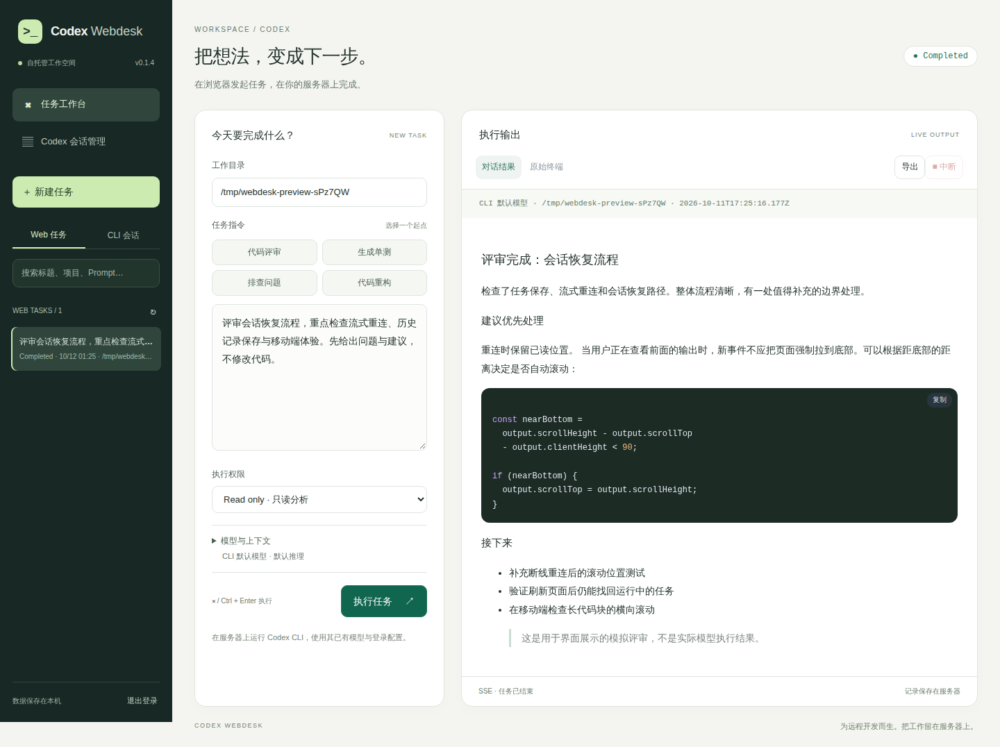

# Codex Webdesk

**把远程 VPS 上的 Codex CLI，变成浏览器中的任务工作台。**

轻量、自托管、单端口、插件式工具导航。浏览器负责输入和查看，任务仍在服务器的项目目录中运行，使用服务器已有的 Codex 登录与配置。MIT 开源，适合个人使用。

[English](docs/README.en.md) · [部署指南](docs/deployment.md) · [架构与接口](docs/architecture.md) · [贡献指南](CONTRIBUTING.md) · [插件接入指南](docs/plugins.md) · [自动发布](docs/releasing.md) · [仓库设置](docs/repository-settings.md) · [迭代规划](docs/roadmap.md)



## 已实现

- 多行 Prompt，Ctrl/Cmd + Enter 提交，代码评审 / 生成单测 / Bug 排查 / 重构预设。
- 自定义模型、推理强度、工作目录、上下文目录、只读 / 项目可写沙箱。
- 单任务执行，SSE 实时输出与重连；刷新浏览器后可重新连接运行中的任务。
- Markdown、代码高亮、代码复制和 xterm ANSI 终端视图。
- SIGINT 中断整个子进程组，4 秒后升级 SIGKILL；服务退出时发送 SIGTERM。
- Web 任务日志持久化为独立 JSON 文件，查看历史、参数回填和 JSON 导出。
- 独立 Codex 会话管理插件：全文搜索、项目/归档筛选、全选、HTML/Markdown/JSON 导出、回收站删除、多会话交接，以及直接在工作台继续。
- 本地工具插件自动注册导航、页面与独立 API；可启停，随附服务器概览示例。
- 自动生成访问 Token，环境变量 / JSON 配置固定 Token，Bearer API 鉴权，HttpOnly 登录 Cookie，登录限速和跨站写入拦截。
- 默认只监听 `127.0.0.1`，可设置工作目录范围；前端依赖本地打包，不加载 CDN。

## 5 分钟开始

要求：Linux / macOS、Node.js **22+**（完整会话管理插件还需 **Python 3.10+**），服务器上安装并配置好 **Codex CLI**。本机参数兼容性核实版本为 `codex-cli 0.160.1`；其他版本应先检查 `codex --help` 和 `codex exec --help`。Windows 的进程树终止尚未验证。

```bash
# 在本项目目录
npm ci
npm run build
node bin/cli.js start --port 8080 --cwd /绝对路径/你的项目
```

首次启动会打印随机 Token 与登录链接。默认每次启动生成新 Token，不写入配置文件；固定 Token 推荐使用环境变量：

```bash
export CODEX_WEBDESK_TOKEN="$(openssl rand -hex 32)"
node bin/cli.js start --port 8080 --cwd /绝对路径/你的项目
```

在**本地电脑**建立 SSH 隧道，然后打开 `http://127.0.0.1:8080`，输入服务器启动时的 Token：

```bash
ssh -N -L 8080:127.0.0.1:8080 your-user@your-vps
```

也支持 `--token`（至少 16 字符）。Token 在命令行参数中可能被进程列表记录，长期使用推荐环境变量或权限为 `600` 的配置文件。

### 本地安装为命令

```bash
npm run build
npm link
codex-webdesk start --port 8080
# 省略 start 也可以
codex-webdesk --port 8080
```

本地验证安装包：

```bash
npm pack
npm install -g ./codex-webdesk-0.1.0.tgz
codex-webdesk --help
```

## 自动发布

推送或合并到 `main` 后，GitHub Actions 自动增加 patch 版本，测试、打包并发布 npm/PyPI，再生成带安装包的 GitHub Release。手动运行 Release 可选择 minor/major；失败重跑保留同一版本。开始新修改前先 `git pull --ff-only`，同步机器人的版本提交。详见 [自动发布指南](docs/releasing.md) 和 [仓库设置说明](docs/repository-settings.md)。

## 安装与升级

运行要求：Node.js 22+、已安装并登录的 Codex CLI。完整会话管理还需 Python 3.10+。Python/uv 安装会自带 Python 启动入口，但不会安装 Node.js 或 Codex。

```bash
# npm 安装 / 升级
npm install -g codex-webdesk
npm install -g codex-webdesk@latest

# uv 安装 / 升级（推荐 Python 渠道）
uv tool install codex-webdesk
uv tool upgrade codex-webdesk
# 若命令目录尚未加入 PATH
uv tool update-shell

# 临时试用指定版本
uvx codex-webdesk@0.1.0 start --cwd /srv/my-project

# 也可在 Python 虚拟环境中使用 pip
python -m pip install codex-webdesk
python -m codex_webdesk --help

codex-webdesk start --cwd /srv/my-project
```

选择 npm 或 uv 其中一个渠道安装，避免同名命令的 PATH 冲突。安装更新不会覆盖用户配置与任务历史。新安装使用 `~/.local/share/codex-webdesk` 和 `~/.config/codex-webdesk/plugins`；新目录不存在时自动沿用旧的 `codex-remote-web` 数据/插件目录。旧环境变量 `CODEX_REMOTE_WEB_TOKEN` 仍兼容，新变量 `CODEX_WEBDESK_TOKEN` 优先。

Python 包内包含与 npm 同版本的 Node 服务、前端和会话管理代码，不在启动时下载 npm 包；默认使用当前 Python 环境执行会话插件。首版支持 Linux/macOS，Windows 未验证。

## 插件式工具接入

内置“任务工作台”和“Codex 会话管理”两个入口。你原有的 history 页面已适配为独立插件，原工具和数据目录保持可继续使用。

新增工具页只需一个 `plugin.json` 和 `public/` 目录；需要后端时加 `server.mjs`，共用登录和端口，不必修改宿主代码。默认扫描 `~/.config/codex-webdesk/plugins/`，重启生效。

```bash
# 试用附带的服务器概览插件
npm start -- --plugins-dir ./examples/plugins
```

详见 [插件接入指南](docs/plugins.md) 和 [完整示例](examples/plugins/server-info)。Python 缺失时完整会话管理显示“需配置”，任务执行和基础历史浏览仍可使用。

## 参数与配置

```bash
codex-webdesk start \
  --host 127.0.0.1 \
  --port 8080 \
  --cwd /srv/projects/my-app \
  --workspace-root /srv/projects \
  --codex-home /home/your-user/.codex
```

| 参数 | 默认值 | 用途 |
| --- | --- | --- |
| `--host` | `127.0.0.1` | 监听地址 |
| `--port` | `8080` | 服务端口 |
| `--token` | 自动生成 | 访问 Token（至少 16 字符） |
| `--cwd` | 启动目录 | 默认工作目录 |
| `--workspace-root` | 不限制 | 校验工作 / 上下文目录的真实路径范围 |
| `--codex-home` | `$CODEX_HOME` 或 `~/.codex` | CLI 配置、登录和会话目录 |
| `--codex-bin` | `codex` | CLI 可执行文件，也可指定绝对路径 |
| `--data-dir` | `~/.local/share/codex-webdesk` | Web 任务 JSON 目录 |
| `--plugins-dir` | `~/.config/codex-webdesk/plugins` | 扫描本地工具插件 |
| `--disable-plugins` | 无 | 逗号分隔的禁用插件 ID |
| `--config` | 无 | JSON 配置文件 |
| `--origin` | 无 | 反向代理下允许的精确浏览器 Origin |
| `--secure-cookie` | 关闭 | HTTPS 部署时设置 Secure Cookie |

配置键使用 camelCase，参考 [config.example.json](config.example.json)。优先级：命令行 > `CODEX_WEBDESK_TOKEN` > 配置文件 > 默认值。登录会话有效期 24 小时，重启服务会使登录 Cookie 失效。

## 与原有 Codex history 的关系

任务页的轻量读取器沿用原有 Python 工具的思路：只展示用户与助手文本，优先使用 `response_item`、回退到 `event_msg`，过滤环境上下文，忽略不完整 JSONL 尾行，不跟随符号链接。任务页独立实现为 Node.js 模块；完整“Codex 会话管理”插件迁入原 Python 库与前端，并通过按需子进程适配，不需要运行原 Python HTTP 服务。不导入现有工具里的私人导出快照、密码或部署配置。

“CLI 会话”页选择记录后，会回填模型与项目目录，进入继续会话模式。编辑 Prompt 后执行，会使用 `codex exec resume <ID> -`；点“取消”改为新任务。归档会话只供查看，需要先通过 Codex CLI 取消归档才能继续。Web 历史选中后回填原 Prompt 和参数，再执行会创建新任务。

任务页侧栏提供摘要搜索；完整插件提供对话全文搜索、删除确认和回收站、多会话合并交接以及 HTML/Markdown/JSON 导出。合并只生成文件和命令，不自动调用模型。完整会话页的“在工作台继续”会切换到任务页并回填会话，编辑后再执行。

## 执行与安全边界

后端使用 `spawn`，不拼接 Shell 命令。Prompt 通过 stdin 传给 CLI，任务使用 `--json`；附加目录映射为 `--add-dir`。默认 `read-only`；生成测试和重构预设会选择 `workspace-write`，执行前可调整。非交互模式固定 `--ask-for-approval never`，无法请求人工审批的动作由 CLI 拒绝。面板不提供无沙箱运行。普通目录也可执行（使用 `--skip-git-repo-check`）。

`workspace-root` 限制可选的工作目录和附加目录，**并不等于隔离服务器文件系统**；CLI 本身的沙箱负责读写与网络限制。Codex 登录、配置和模型可用性由服务器现有配置决定，前端模型选项仅为输入示例，可填写自己的模型标识。Temperature / Max Tokens 没有硬塞为未经核实的 CLI 参数。

页面外壳和宿主打包静态资源可公开加载，所有历史、任务、配置、插件 API 及插件页面资源均需登录。登录 Token 链接由浏览器读取后立即移除，再换取 HttpOnly Cookie，SSE URL 不携带 Token；首次请求的查询参数仍可能出现在反向代理访问日志，生产环境可手动输入 Token。失败登录按来源地址限流：5 分钟内 10 次；反向代理后地址共享，应结合代理自己的限速设置。API 不开放 CORS，不信任 `X-Forwarded-For`。

公网访问请使用 HTTPS 反向代理，详见部署指南。不要把未加密的服务直接暴露到公网。持有 Token 的用户能够执行 CLI 任务、读取会话记录，应按服务器访问凭据保管。Markdown 经 DOMPurify 清洗；Raw Terminal 只显示输出，不提供交互输入。

## 验证

```bash
npm run check
npm test
npm run build
npm run test:package
# 可选浏览器闭环验证（使用模拟 CLI，不调用模型，不收费）
npx playwright install chromium
npm run test:browser
```

自动测试覆盖鉴权、Cookie 注销、来源校验、限速、参数校验、单任务锁、SSE 重放、子进程组终止、日志持久化、启动失败、重启恢复和历史读取。浏览器测试覆盖插件切换、自定义工具 API、完整历史全文搜索和 HTML 导出、直接继续、登录、预设、流式输出、终端、XSS 清洗、快捷键、刷新恢复、中断、移动布局与注销。

测试使用模拟 CLI 和临时会话目录；插件集成测试需要 Python 3.10+。不会调用付费模型，也不会修改你的真实会话。当前未做真实模型端到端执行和内存基准测试。

## MVP 限制与路线图

- 一次一个任务，无任务队列、多人隔离和 Web 审批交互。
- 后端 HTTP、进程管理、插件注册与文件存储使用 Node 标准库；完整 history 插件使用 Python 标准库；前端使用原生 JS + esbuild，无 React/Vue 运行时。
- JSON 任务日志原子写入，运行中约每秒落盘，突然断电可能丢失最后约一秒日志。重启后未完成任务标记为 interrupted，不自动重跑。
- 单任务 Raw 保留约 400 万字符、结构化回答约 200 万字符、事件约 8 MB / 20000 条；达到上限会显示截断提示。历史详情最多保留约 200 万字符。任务文件总量不自动清理，运行时会载入 Web 历史；长期使用需自行归档。
- 原生历史列表按需扫描 JSONL，大量会话的索引与分页留待后续优化；不读取 Codex 内部数据库，未来 CLI 存储格式变化可能需要适配。
- 下一步：更多工具插件、队列与多工作区、Codex app-server 审批与交互会话、历史索引和分页、数据清理与性能基准。

CLI 集成参考：[官方非交互模式文档](https://developers.openai.com/codex/noninteractive)。本项目为独立社区工具，与 OpenAI 无隶属关系。

## License

[MIT](LICENSE)。打包的前端第三方库许可证保留在 `dist/third-party-licenses.txt`。
