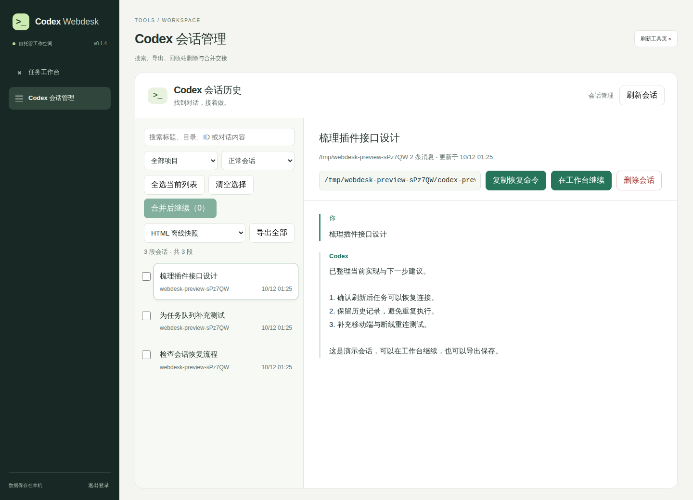

<div align="center">

# Codex Webdesk

### 你的 Codex 工作台，打开浏览器就到。

在服务器上运行任务，在浏览器里查看进展。
找回昨天的对话，接着把事情做完。

[](https://www.npmjs.com/package/codex-webdesk)
[](https://pypi.org/project/codex-webdesk/)
[](https://github.com/chao5go/codex-webdesk/actions/workflows/ci.yml)
[](LICENSE)

[English](docs/README.en.md) · [快速开始](#快速开始) · [部署指南](docs/deployment.md) · [插件](docs/plugins.md) · [配置参考](docs/reference.md)

</div>


## 从终端出发，多一个顺手的入口

代码在远程服务器上，任务运行到一半，你想换台电脑看看进展；昨天的 Codex 会话还有上下文，今天想接着完成。Webdesk 把这些操作放到一个浏览器工作区里，使用服务器已有的 Codex 登录和配置。

| 你想做的事 | Webdesk 如何帮你 |
| --- | --- |
| 开始一项任务 | 输入目标，选择工作目录；代码评审、单测、排错、重构预设随手可用 |
| 跟上执行过程 | 实时 Markdown、代码高亮与复制，随时切换原始终端输出 |
| 关掉标签页后回来 | 任务在服务端继续运行，刷新后重新连接；结果保存为本地记录 |
| 接着昨天的工作 | 搜索原生 Codex 会话，带着原来的上下文回到工作台继续 |
| 整理与带走对话 | 全文搜索、项目筛选、HTML / Markdown / JSON 导出、回收站与多会话交接 |
| 接入自己的工具 | 本地插件共用导航、登录和服务端口 |

自托管 · 无需数据库 · 前端资源本地打包 · MIT 开源

## 快速开始

服务器需要 **Node.js 22+** 和已安装、登录的 **Codex CLI**。完整会话管理需要 **Python 3.10+**；支持 Linux / macOS。

任选一个安装渠道：

```bash
# 临时运行，无需全局安装
npx codex-webdesk start --cwd /srv/my-project

# 或使用 uv
uvx codex-webdesk start --cwd /srv/my-project
```

启动后会打印访问 Token 和登录链接。服务默认监听 `127.0.0.1:8080`。在本地电脑建立隧道：

```bash
ssh -N -L 8080:127.0.0.1:8080 your-user@your-server
```

打开 **http://127.0.0.1:8080**，输入启动时的 Token，就可以发起任务了。

> uv / pip 包包含完整 Webdesk 服务和前端，但仍需要系统上的 Node.js 与 Codex CLI。截图使用模拟任务，不代表真实模型输出。

### 安装为常用命令

```bash
# uv（推荐 Python 用户）
uv tool install codex-webdesk
uv tool upgrade codex-webdesk          # 以后升级

# npm
npm install -g codex-webdesk
npm install -g codex-webdesk@latest    # 以后升级

codex-webdesk start --cwd /srv/my-project
```

选择一个渠道即可，避免同名命令冲突。也支持 `pip install codex-webdesk`（在虚拟环境中）。升级后重启服务生效；用户配置和历史不会被安装包覆盖。

<details>
<summary>从源码运行与验证</summary>

```bash
git clone https://github.com/chao5go/codex-webdesk.git
cd codex-webdesk
npm ci
npm run build
npm start -- --cwd /srv/my-project

npm run check
npm test
npx playwright install chromium
npm run test:browser
```

浏览器测试使用模拟 CLI 与临时目录，不调用模型。

</details>

## 找到对话，接着做

任务侧栏用于快速查看 Web 任务和 CLI 会话；完整会话页适合搜索内容、整理记录和导出。点击“在工作台继续”，补充下一步目标后再执行。



## 部署与扩展

- **长期运行**：[部署指南](docs/deployment.md)，包括固定 Token、SSH 隧道和 HTTPS 反向代理。
- **按项目配置**：[参数与行为参考](docs/reference.md)、[配置示例](config.example.json)。
- **增加工具页**：[插件开发](docs/plugins.md)与[服务器概览示例](examples/plugins/server-info)。
- **参与开发**：[贡献指南](CONTRIBUTING.md)、[架构](docs/architecture.md)、[迭代规划](docs/roadmap.md)。
- **发布自己的版本**：[自动发布](docs/releasing.md)、[GitHub 仓库设置](docs/repository-settings.md)。推送 main 自动升级版本并发布 npm、PyPI 和 GitHub Release。

## 当前边界

面向个人远程开发，一次执行一个任务。默认只读，生成单测和重构预设会选择项目可写权限，提交前可调整。不提供多人隔离、交互终端或浏览器审批。关闭浏览器不影响任务；停止 Webdesk 服务会中断任务。公网部署请使用 HTTPS，访问 Token 按服务器凭据保管。

Webdesk 是独立社区项目，与 OpenAI 无隶属关系。[MIT](LICENSE) · 第三方许可证随安装包提供。
