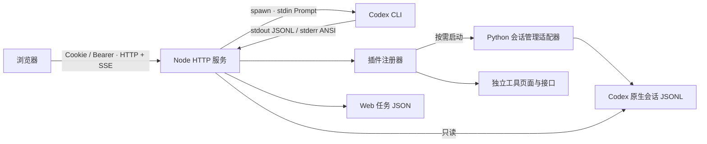

# 架构与 API



`bin/cli.js` 处理参数、配置、Token 和服务生命周期。`src/server.js` 管理统一鉴权和宿主生命周期。`src/plugins.js` 管理插件注册、独立 API、静态资源与启停。`src/builtins/workbench.js` 管理任务路由与 SSE。`src/builtins/codex-history.js` 适配原 Python 会话管理库，通过按需子进程提供完整管理功能。`src/tasks.js` 验证目录、生成 CLI 参数、管理进程组、解析 JSONL、持久化记录。`src/history.js` 按原有 history 工具的数据规则读取原生历史。`web/app.js` 提供导航与登录宿主，`web/workbench.js` 维护任务页，插件独立页面通过 iframe 加载。`web/` 为前端源码，`npm run build` 生成 `dist/` 并随 npm 包交付。

服务用户需要提前安装并配置 Codex。工作台不调用 OpenAI API，不管理 API Key，不改变原生配置；CLI 会按照其自身配置调用模型。

## HTTP API

所有 `/api/*` 路由（登录除外）需要 Cookie 或 `Authorization: Bearer <token>`。请求体为 JSON。Cookie 的写入请求必须携带同源 Origin；Bearer 适合自动化客户端。错误格式为 `{ "error": "描述" }`。

| 方法 | 路由 | 行为 |
| --- | --- | --- |
| POST | `/api/login` | `{token}`，设置 HttpOnly Cookie |
| POST | `/api/logout` | 撤销当前 Cookie 会话 |
| GET | `/api/config` | 默认目录、活动任务 ID、版本，无 Token |
| GET | `/api/plugins` | 已注册插件和可用状态 |
| GET | `/plugins/:id/*` | 受鉴权保护的插件页面资源 |
| ANY | `/api/plugins/:id/*` | 插件自己的接口，详见插件指南 |
| GET | `/api/tasks` | Web 任务摘要 |
| POST | `/api/tasks` | 创建任务，返回 201 `{id}`；已有任务时 409 |
| GET | `/api/tasks/:id` | 任务详情，包括事件 / 原始输出 / 最终回答 |
| GET | `/api/tasks/:id/events?after=N` | SSE 重放 N 后的事件；也支持 Last-Event-ID |
| POST | `/api/tasks/:id/stop` | `{signal:"SIGINT"}` 或 SIGTERM |
| GET | `/api/sessions` | 重新扫描本机原生会话摘要 |
| GET | `/api/sessions/:id` | 用户 / 助手对话详情 |
| GET | `/api/sessions/:id/export` | JSON 下载 |

创建任务示例：

```json
{
  "prompt": "Review the authentication implementation",
  "cwd": "/srv/projects/my-app",
  "model": "",
  "effort": "high",
  "sandbox": "read-only",
  "contextPaths": [],
  "resumeId": ""
}
```

`model` 和 `effort` 留空时沿用 CLI 配置。`contextPaths` 最多 8 项，全部为存在的绝对目录。可选 `resumeId` 必须对应已读取的、未归档原生会话 UUID。

SSE 使用默认事件的 JSON data：

```text
id: 1
data: {"seq":1,"type":"raw","data":{"stream":"stderr","text":"..."}}

id: 2
data: {"seq":2,"type":"codex","data":{"type":"thread.started","thread_id":"..."}}

id: 3
data: {"seq":3,"type":"status","data":{"status":"completed","exitCode":0}}
```

`raw` 保留 CLI 输出；`codex` 为解析出的事件；`status` 结束任务。客户端按 seq 去重。15 秒心跳保持连接，任务完成关闭 SSE。慢客户端超过约 1 MB 待发送缓冲时断开，可从最后事件重新连接。最多 64 个 SSE 连接。

## 生命周期

任务状态：`running → completed / failed`，停止：`running → stopping → interrupted`。启动 CLI 失败同样保存为 failed。服务重启时把遗留 running/stopping 记录改为 interrupted，保留已有输出，不自动继续。单任务锁在目录验证前取得，避免并发请求绕过。

运行中定时落盘；完成时立即原子 rename。数据目录权限默认 700，记录默认 600。Prompt 从 stdin 输入；命令参数使用数组，无 shell。Linux/macOS 上为 CLI 建立独立进程组，中断整个组。浏览器关闭不会终止任务，服务关闭会终止任务。

## 扩展方向

工具页接入使用 [插件协议](plugins.md)，无需改动宿主。会话管理的删除、合并及离线导出已迁入独立插件，保留确认、回收站和运行中会话检测。

原生会话目前以 JSONL 为兼容层。正式的多人交互、审批与持续对话建议增加 Codex app-server 适配器，而非模拟终端按键。插件与服务共享用户权限，只加载可信本地代码。
